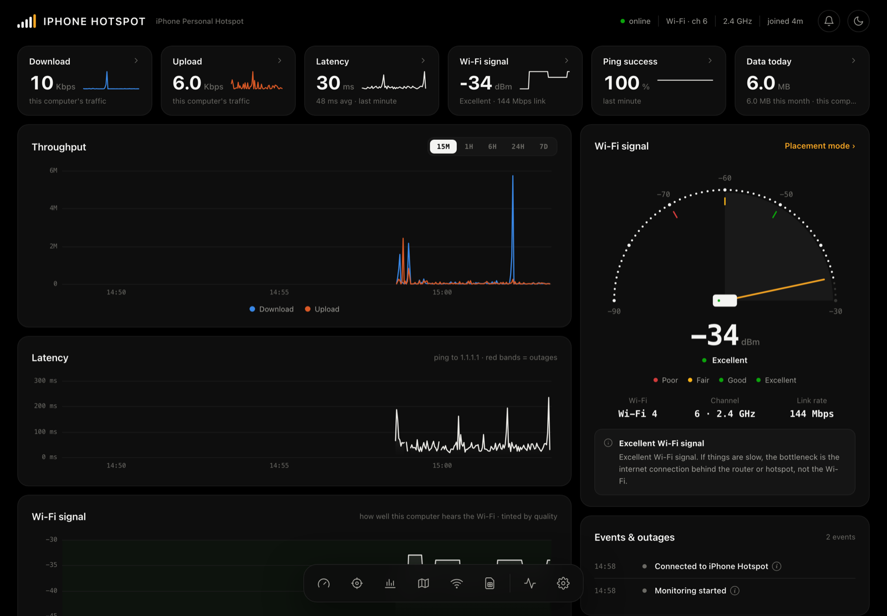

# Fivebars

**Know your connection.** Fivebars is a free, open-source dashboard for your internet connection on **macOS and Windows**. It works with any ISP and any network (home router, phone hotspot, office Wi-Fi), and it shows much more on supported 4G home routers.



## What it does

- **Live speed, latency and signal**, with history charts (15 min to 7 days).
- **Events & outages log**: dropped connections, "internet not responding", weak signal, high latency, mast switches, new public IP, devices joining or leaving. It sends desktop notifications if you turn them on.
- **Internet check**: tests each link (computer → router → internet → DNS → web) and tells you which one is broken and what to do.
- **Speed test**, with a history of past results.
- **Data usage** per network (hourly and daily), and per network across every network you join.
- **Placement mode**: compare spots in your home to find the best signal.
- **Coverage map**: every mapped mobile mast in your country from [OpenCellID](https://opencellid.org), coloured by provider, with approximate coverage areas and the mast you're most likely connected to.
- **Works on any network.** Each network you join (identified by its router) keeps its own history, name and usage.

### Extra features on supported 4G routers

On routers with ZTE "goform" firmware (the web interface used by many carrier-branded 4G home routers, such as the MTN Broadband 4G CPE), Fivebars also shows:
- 4G signal (RSRP), band and the mast/cell ID;
- SIM and router details;
- connected devices, which you can name;
- balance checks via USSD.

Router support is the main thing we want help with: see [Adding a router](CONTRIBUTING.md#adding-a-router).

| | Any network | Supported 4G router |
|---|---|---|
| Speed, latency, outages, speed test, internet check | ✅ (this computer's traffic) | ✅ (whole network) |
| Signal | Wi-Fi signal (RSSI) | 4G signal (RSRP), band, mast |
| Connected devices, SIM info, balance (USSD) | – | ✅ |
| Coverage map | Masts near you | Masts near you + your likely mast |

## Install

### Download (easiest)

Get the latest **Fivebars-macOS.zip** or **Fivebars-Windows.zip** from [Releases](../../releases), unzip it, and open Fivebars. The dashboard opens in its own window.

The builds aren't code-signed yet, so the first launch shows a warning:
- **macOS:** right-click **Fivebars.app** → **Open** → **Open**.
- **Windows:** in the SmartScreen prompt, click **More info** → **Run anyway**.

### Run from source

You need Python 3.9 or newer, and nothing else: no extra packages.

```bash
git clone https://github.com/<you>/fivebars.git
cd fivebars
python3 fivebars.py        # macOS
py fivebars.py             # Windows
```

You can also double-click **Fivebars.command** (macOS) or **Fivebars.bat** (Windows). The dashboard runs at <http://localhost:8555>. To stop it, use **Settings → Fivebars → Quit**.

## Setup (optional)

Open **Settings → Fivebars setup**:

| Setting | Why |
|---|---|
| **Router admin password** | Only for supported 4G routers. The factory default `admin` is tried automatically. |
| **OpenCellID API key** | Free from [opencellid.org](https://opencellid.org/register.php). Used to download your country's mast list for the coverage map. |
| **Country** | Which country's masts to download. Detected automatically from a 4G router's SIM. |

**Network names:** macOS hides Wi-Fi network names from apps, so click the network name at the top left to name a network yourself. (Advanced: running `sudo ipconfig setverbose 1` once lets Fivebars read the names.)

## Privacy

Fivebars is local-first:
- All history, settings, passwords and your location stay on your computer, in `~/Library/Application Support/Fivebars` (macOS) or `%APPDATA%\Fivebars` (Windows).
- The dashboard only accepts connections from your own computer (`127.0.0.1`).
- No accounts, analytics or telemetry.

The only outside traffic:
- a 1-packet ping to `1.1.1.1` every 2 seconds, to measure latency;
- map tiles from Stadia Maps;
- things you trigger yourself: speed tests (Cloudflare), tower downloads (OpenCellID) and balance checks (sent by your router to your operator).

## Data sources & credits

- **Mast data:** [OpenCellID](https://opencellid.org), licensed [CC BY-SA 4.0](https://creativecommons.org/licenses/by-sa/4.0/). It's crowdsourced, so rural areas and some operators are under-recorded. Contributing measurements helps everyone.
- **Maps:** © [Stadia Maps](https://stadiamaps.com) © [OpenMapTiles](https://openmaptiles.org) © [OpenStreetMap](https://www.openstreetmap.org/copyright) contributors. Rendered with [Leaflet](https://leafletjs.com) (BSD-2-Clause, bundled in `web/vendor`).
- **Speed test:** Cloudflare's public speed endpoints.

## Limitations

- **Windows Wi-Fi details** come from `netsh` and are parsed reliably only on English-language Windows; other languages fall back to the basic view.
- **Signal-based distance to the mast** and the coverage circles are rough estimates.
- **Coverage-map accuracy** depends on how well your area is recorded in OpenCellID.

## Development

```bash
python tests/test_netprobe.py   # parser unit tests (macOS + Windows samples)
python tests/smoke.py           # starts Fivebars and checks every endpoint
pyinstaller packaging/fivebars.spec   # build Fivebars.app / Fivebars.exe
```

CI runs all of this on macOS and Windows for every push. Pushing a `v*` tag publishes a release with both builds. See [CONTRIBUTING.md](CONTRIBUTING.md).

## License

[MIT](LICENSE)
